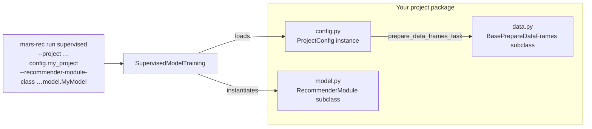

# Concepts

Every MARS-Rec project is made of three pieces that are wired together by **dotted import paths**:

| Page | What you will learn |
|---|---|
| [ProjectConfig & columns](project-config.md) | The central contract: columns, `IOType`, dataset classes |
| [Models](models.md) | `RecommenderModule`, `forward()` argument order and output shape |
| [Pipeline](pipeline.md) | What happens from raw data to metrics, and how the split works |
| [Index mapping](index-mapping.md) | How categorical values become embedding indices |
| [Outputs & caching](outputs.md) | The artifact layout and Luigi's caching behaviour |
