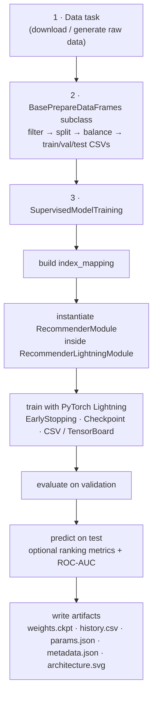

# Pipeline

`mars-rec run supervised` schedules a chain of Luigi tasks. Each task runs only if its outputs
are missing.



## 1. Raw data

Any Luigi task that produces a file works. The bundled examples download public datasets.
[`BaseDownloadDataset`][mars_rec.data.task.BaseDownloadDataset] covers the single-URL case.

## 2. Data preparation

[`BasePrepareDataFrames`][mars_rec.data.task.BasePrepareDataFrames] reads the raw DataFrame and:

1. Applies `eq_filters`, `neq_filters` and `isin_filters`, in that order.
2. Creates the `available_items` column when it is missing.
3. Splits the data into **train / validation / test**:
    - **Test** split (`test_size`, default `0.2`): `test_split_type=random` (default) or `time`.
    - **Validation** split (`val_size`, default `0.2`, carved from the remaining train rows), using
      the method set by `dataset_split_method`:

        | Method | Behaviour |
        |---|---|
        | `time` (default) | Sort by `timestamp_property`. The most recent slice becomes validation |
        | `holdout` | Random split |
        | `column` | Partition the unique values of `column_stratification` (e.g. all rows of a user stay on one side) |
        | `k_fold` | Stratified K-fold (`n_splits`, `split_index`) |

4. Optionally balances train (and validation) with `sampling_strategy=oversample|undersample`.
5. Calls `transform_data_frame(df, data_key)` on each split and writes the three CSVs.

You can run this step on its own:

```bash
mars-rec run data examples.movielens.data PrepareMovieLensDataFrame
```

## 3. Training and evaluation

[`SupervisedModelTraining`][mars_rec.simulation.training.SupervisedModelTraining] loads the CSVs,
builds the [index mapping](index-mapping.md), wraps your model in
[`RecommenderLightningModule`][mars_rec.torch.lightning_module.RecommenderLightningModule] and
trains it. It then:

- evaluates on validation with the configured `metrics`;
- scores the test split and writes `test_set_predictions.csv`;
- with `ranking_metrics=True`, computes NDCG / HitRate / MRR / MAP @{5, 10, 20} and ROC-AUC into
  `metadata.json`;
- renders `architecture.svg` next to the checkpoint.

For every knob, see [Training parameters](../guides/training-parameters.md).

## After training

Two standalone entry points reuse the saved artifacts:

- [`run_inference`][mars_rec.inference.run_inference] (`mars-rec predict`) writes the top-k items per user.
- [`run_evaluate`][mars_rec.simulation.training.run_evaluate] (`mars-rec evaluate`) re-runs evaluation
  on the original splits or on an external dataset.

See [Inference & evaluation](../guides/inference-evaluation.md).
