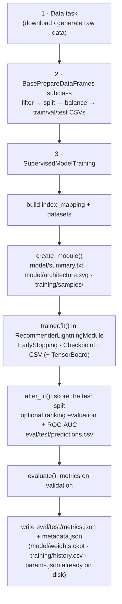

# Pipeline

`mars-rec run supervised` schedules a chain of Luigi tasks. Each task runs only if its outputs
are missing.



## 1. Raw data

Any Luigi task that produces a file works. The bundled examples download public datasets.
[`BaseDownloadDataset`][mars_rec.data.task.BaseDownloadDataset] covers the single-URL case.

## 2. Data preparation

[`BasePrepareDataFrames`][mars_rec.data.task.BasePrepareDataFrames] reads the raw DataFrame and:

1. Applies `eq_filters`, `neq_filters` and `isin_filters`, in that order.
2. Creates the `available_items` column when it is missing (seeded by `seed`, so slates are reproducible).
   The column is only read when the `ProjectConfig` sets `available_items_column_name`.
3. Splits the data into **train / validation / test**:
    - **Test** split (`test_size`, default `0.2`): `test_split_type=random` (default) or `time`.
    - **Validation** split (`val_size`, default `0.2`, carved from the remaining train rows), using
      the method set by `dataset_split_method`:

        | Method | Behaviour |
        |---|---|
        | `time` (default) | Sort by `timestamp_property`. The most recent slice becomes validation |
        | `holdout` | Random split |
        | `column` | Partition the unique values of `column_stratification` (e.g. all rows of a user stay on one side) |
        | `k_fold` | K-fold (`n_splits`, `split_index`), stratified on `stratification_property` when the task defines one |

4. Optionally balances train (and validation) with `sampling_strategy=oversample|undersample`.
5. Calls `transform_data_frame(df, data_key)` on each split and writes the three CSVs.

You can run this step on its own:

```bash
mars-rec run data examples.movielens.data PrepareMovieLensDataFrame
```

## 3. Training and evaluation

[`SupervisedModelTraining`][mars_rec.simulation.training.SupervisedModelTraining] loads the CSVs,
builds the [index mapping](index-mapping.md) and the datasets, then:

1. instantiates your model and writes `model/summary.txt`, `model/architecture.svg` and the
   `training/samples/` CSVs;
2. wraps it in
   [`RecommenderLightningModule`][mars_rec.torch.lightning_module.RecommenderLightningModule] and
   trains it, writing `model/weights.ckpt`, `training/history.csv` and `training/plot_history.jpg`;
3. plots the test-split classification curves. With `ranking_metrics=True` it also runs the
   [ranking evaluation](evaluation.md): it ranks the full catalog per test query, writes the top-k
   lists to `eval/test/predictions.csv` and computes the ranking metrics, a popularity baseline and
   ROC-AUC;
4. evaluates the configured `metrics` on the validation split;
5. writes `metadata.json`.

### Customising the training task

The steps above are methods of
[`TorchModelTraining`][mars_rec.simulation.training.TorchModelTraining]. To change one of them,
subclass `SupervisedModelTraining` in your project, override the hook you need, and run it with
`--task-class`:

| Hook | Override it to… |
|---|---|
| `create_module()` | build the model differently (e.g. load pretrained weights) |
| `create_lightning_module(module)` | wrap the model in a custom `LightningModule` |
| `create_trainer()` | add Lightning callbacks or change trainer flags |
| `get_train_generator()` / `get_val_generator()` / `get_test_generator()` | change how batches are sampled |
| `after_fit()` | write extra artifacts after training (call `super().after_fit()`) |
| `evaluate()` | change the validation evaluation |

```python title="my_project/training.py"
from mars_rec.simulation.training import SupervisedModelTraining


class MyTraining(SupervisedModelTraining):
    def create_trainer(self, log_every_n_steps: int = 50):
        trainer = super().create_trainer(log_every_n_steps)
        ...  # e.g. trainer.callbacks.append(MyCallback())
        return trainer
```

```bash
mars-rec run supervised --task-class my_project.training.MyTraining --project ... --recommender-module-class ...
```

For every knob, see [Training parameters](../guides/training-parameters.md).

## After training

Two standalone entry points reuse the saved artifacts:

- [`run_inference`][mars_rec.inference.run_inference] (`mars-rec predict`) writes the top-k items per user.
- [`run_evaluate`][mars_rec.simulation.training.run_evaluate] (`mars-rec evaluate`) re-runs evaluation
  on the original splits or on an external dataset.

See [Inference & evaluation](../guides/inference-evaluation.md).
